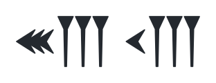
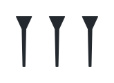
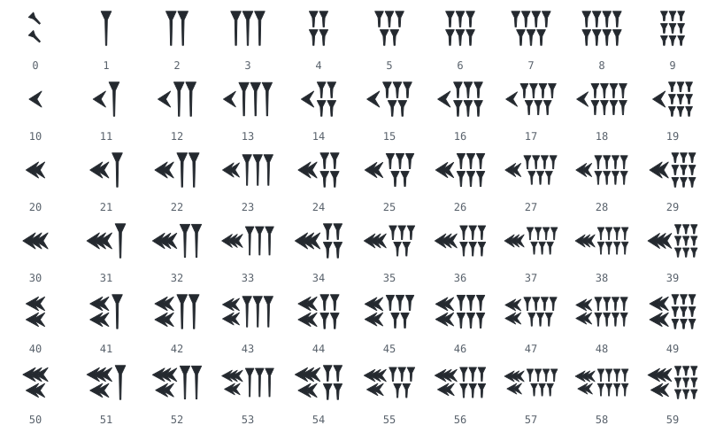

# babylonian-numerals

Render any number as [Babylonian cuneiform numerals](https://en.wikipedia.org/wiki/Babylonian_cuneiform_numerals): SVG with zero dependencies, plus PNG, JPEG and WebP through [sharp](https://sharp.pixelplumbing.com/).

**[Docs and playground](https://karlnorling.github.io/babylonian-numerals/)** · [Storybook](https://karlnorling.github.io/babylonian-numerals/storybook/)

| Package                                             | What it does                                     |
| --------------------------------------------------- | ------------------------------------------------ |
| [`@babylonian/core`](packages/@babylonian/core)     | Numbers to SVG. No dependencies, runs anywhere.  |
| [`@babylonian/raster`](packages/@babylonian/raster) | Numbers to PNG, JPEG or WebP in Node, via sharp. |
| [`@babylonian/cli`](packages/@babylonian/cli)       | The `babylonian` command.                        |

<p>
  
  
  
  
</p>
<p>
  
  
</p>

Babylonian scribes wrote numbers with two wedge shapes pressed into clay: a corner wedge for ten and an upright wedge for one. Up to five tens and nine ones make a digit from 1 to 59, and places count in sixties. Our 60 minutes and 360 degrees come from this system.



## Usage

```sh
npm install @babylonian/core
```

```js
import { toSvg } from '@babylonian/core';

const svg = toSvg(1993);
const red = toSvg(1993, { size: 200, color: '#c00', background: 'white' });
```

```sh
npm install @babylonian/raster
```

```js
import { toImage } from '@babylonian/raster';
import { writeFile } from 'node:fs/promises';

await writeFile('1993.webp', await toImage(1993, { format: 'webp', size: 400 }));
```

### Command line

```sh
npx @babylonian/cli 1993 > 1993.svg
npx @babylonian/cli 12.5 -o half.webp --size 200
npx @babylonian/cli -42 -o minus.png
```

Installed globally (`npm install -g @babylonian/cli`), the command is `babylonian`. Run `babylonian --help` for every option.

### Colours and gradients

`color` and `background` take any CSS colour, or a CSS gradient: `linear-gradient()`, `radial-gradient()` and their `repeating-` forms. A gradient spans the whole image.

```js
// Rainbow
toSvg('1234567', {
  color: 'linear-gradient(to right, #e03131, #f76707, #fab005, #40c057, #228be6, #7048e8, #be4bdb)',
});

// Christmas
toSvg('2026.1225', {
  color: 'repeating-linear-gradient(135deg, #e03131 0 3%, #ffffff 3% 6%)',
  background: 'radial-gradient(#2b8a3e, #0b3d20)',
});
```

## Numbers the Babylonians didn't write

Babylonian numerals were positional in base 60, but scribes wrote no point between the whole number and the fraction, and for most of the period no zero. This library fills those gaps so every number has one drawing:

| Input  | Drawn as                    | Rule                                                                                                              |
| ------ | --------------------------- | ----------------------------------------------------------------------------------------------------------------- |
| `3601` | 1, placeholder, 1           | Empty places get two slanted wedges, the sign late Babylonian scribes used. `zero: 'space'` leaves a gap instead. |
| `0`    | the placeholder             | Zero on its own always shows the placeholder.                                                                     |
| `12.5` | 12, a dot, 30               | A dot on the baseline starts the fraction. Each place after it is worth a sixtieth of the one before.             |
| `0.01` | 0, a dot, 0, 36             | Every decimal fraction is exact in base 60, so nothing is rounded.                                                |
| `-42`  | a horizontal wedge, then 42 | A horizontal wedge before the number marks it negative.                                                           |

The dot, the minus wedge and a placeholder at the end of a number are modern additions; scribes read those from context.

Inputs can be a `number`, a `bigint` or a decimal `string`. A number is first written in its shortest exact form, so `0.1` draws as `0.1`. Strings and bigints keep every digit.

## API

### `toSvg(value, options?)` → `string` from `@babylonian/core`

| Option       | Default        | Notes                                                                                                                                |
| ------------ | -------------- | ------------------------------------------------------------------------------------------------------------------------------------ |
| `size`       | `100`          | Image height in pixels. The width follows from the number of places.                                                                 |
| `color`      | `currentColor` | Colour of the wedges. Takes a colour or a gradient.                                                                                  |
| `background` | none           | Colour or gradient behind the numeral.                                                                                               |
| `gap`        | `22`           | Space between places, in viewBox units.                                                                                              |
| `padding`    | `20`           | Space around the numeral, in viewBox units.                                                                                          |
| `zero`       | `placeholder`  | `placeholder` draws an empty place as two slanted wedges, as late Babylonian scribes did. `space` leaves a gap, as earlier ones did. |
| `title`      | the number     | Accessible name. `false` leaves it out and sets `aria-hidden`.                                                                       |

### `toImage(value, options?)` → `Promise<Buffer>` from `@babylonian/raster`

Takes every `toSvg` option, plus `format` (`png`, `jpeg`, `jpg` or `webp`; default `png`) and `quality` (1–100). Colours default to black. JPEG gets a white background unless you pass one.

### Lower level, from `@babylonian/core`

- `parse(value)` → `{ negative, integer, fraction }`: the base-60 digits that get drawn.
- `format(parsed)` → the canonical decimal string, e.g. `-12.5`.
- `digitSvg(digit, place?, options?)` → one digit on its own.
- `parseGradient(css)` → the object form of a CSS gradient string, or `undefined` for a plain colour.
- `formatSexagesimal(value)` → the number in the notation historians use, with commas between places and a semicolon before the fraction: `1;30` for 1.5.
- `digitShape(digit)` → the wedge outlines of one digit, for drawing somewhere else.

## Development

```sh
yarn install
yarn test        # all packages, straight from source
yarn build       # core, then raster, then cli
yarn docs        # docs site with the playground, on localhost:4322
yarn storybook   # Storybook on localhost:6006
yarn examples    # regenerate examples/
```

## License

MIT
